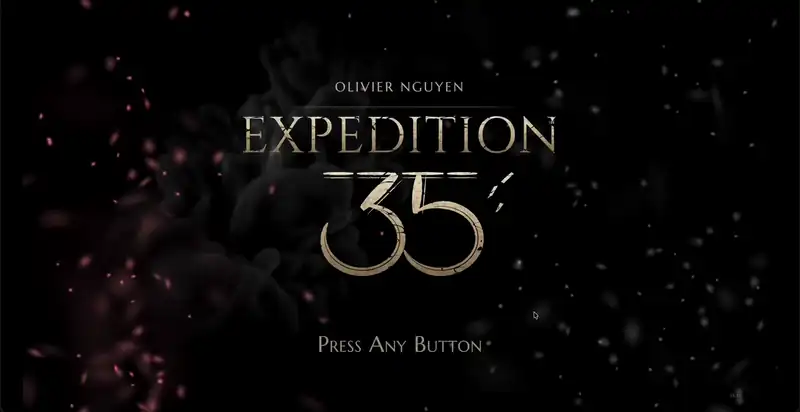
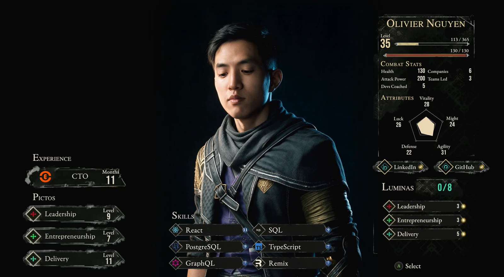
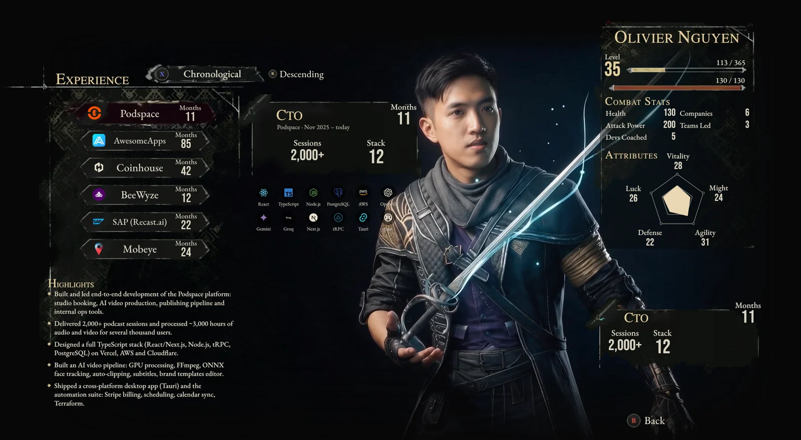
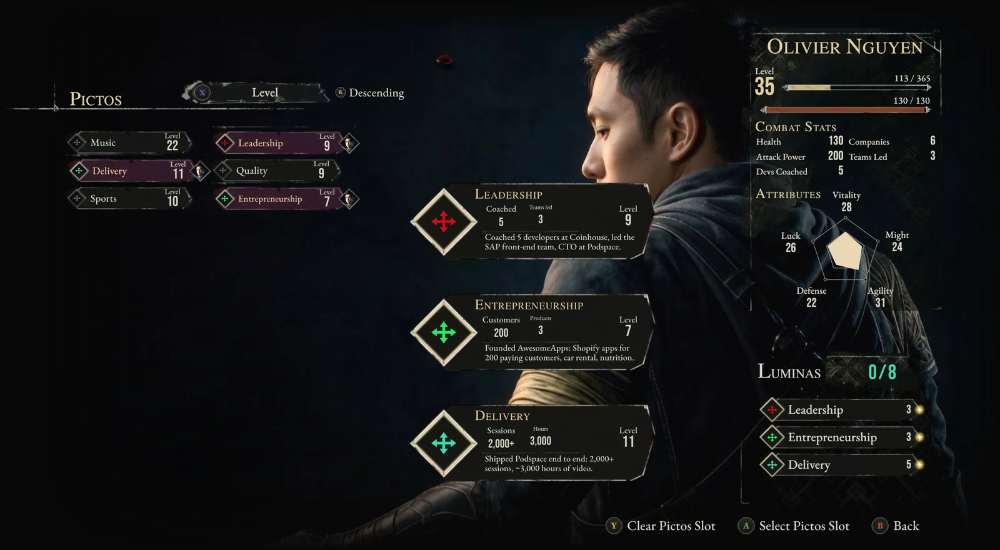
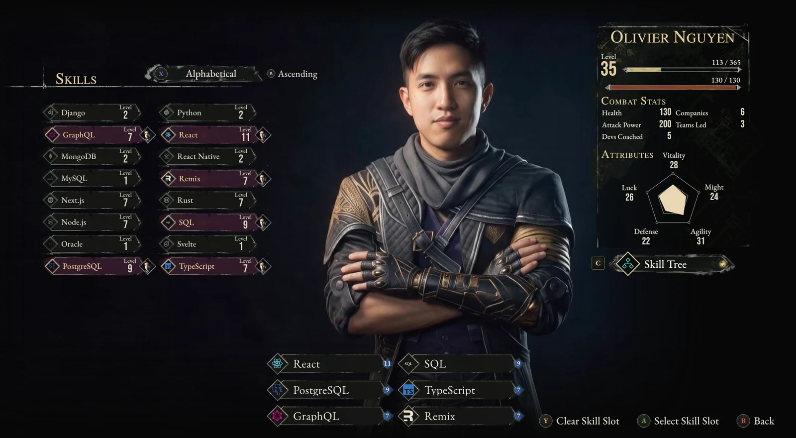
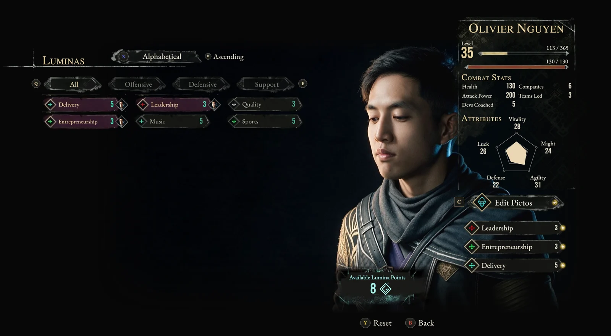
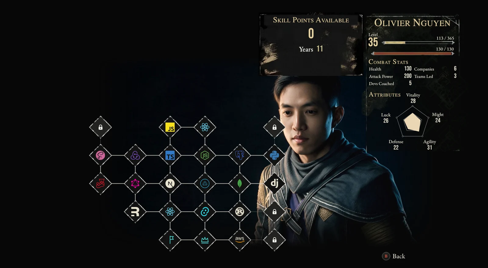

# Expedition 35

**My CV, rebuilt as the menu of _Clair Obscur: Expedition 33_.** Positions are weapons, qualities are Pictos and Luminas,
technologies fill the skill tree, and my level is my age. The character is me, animated: every screen has its own idle
loop and every move between screens its own camera transition, as in the game.

**[▶ Live demo](https://oliviernguyen.github.io/clair-obscur-expedition-cv/)** · best in a desktop browser, in landscape on a phone.

[](https://oliviernguyen.github.io/clair-obscur-expedition-cv/demo.mp4)

_The full tour, 32 s: [watch it](https://oliviernguyen.github.io/clair-obscur-expedition-cv/demo.mp4)._

|                                                                 |                                                                          |
| --------------------------------------------------------------- | ------------------------------------------------------------------------ |
|                      |                           |
| **Overview**: the equipped position, Pictos, skills and Luminas | **Experience**: each position as a weapon, with its stack and highlights |
|                          |                                   |
| **Pictos**: qualities, with figures                             | **Skills**: technologies, levelled in years of use                       |
|                        |                           |
| **Luminas**: spend points on qualities, as in the game          | **Skill Tree**: every technology, and where it was used                  |

## Features

- **Faithful to the game's menus**: layouts, textures, type and key hints measured against gameplay footage, down to
  the pixel on a 2510 × 1380 stage scaled to the window.
- **An animated character**: AI-generated stills of me in the expedition outfit, an idle loop per screen and a camera
  move between screens, handed over without a cut.
- **A title screen with a loading bar**: every clip loads behind it, so no camera move ever falls back to a cut, then
  _Press Any Button_.
- **Keyboard and controller-style navigation**: arrows, A/Enter, B/Escape, Y, Q/E and the on-screen hints, as in the game.
- **Your loadout is kept**: equipped Pictos, skills and Luminas persist in the browser.
- **One place to edit the CV**: every piece of content lives in [`app/data`](app/data).

## Run it

The live demo is deployed to GitHub Pages by [`.github/workflows/pages.yml`](.github/workflows/pages.yml) on every
push to `main`, once the checks pass (`pnpm build:pages` prerenders every screen as static HTML into `site/`). It is
also rebuilt daily, since the level's XP bar moves each day; GitHub turns off a public repository's scheduled
workflows after 60 days without a commit, and enabling the workflow again in the Actions tab resumes it.

Requires Node 24+ (`.nvmrc`) and pnpm 11 (`corepack enable` installs the version pinned in `package.json`).

```bash
pnpm install
pnpm dev          # http://localhost:5173
```

```bash
pnpm build && pnpm start          # production server on http://localhost:3000
docker build -t expedition . && docker run -p 3000:3000 expedition
```

`DEV_KIT=true pnpm dev` also mounts `/dev/kit`, a bench of every UI-kit component, never part of the public build.

### Checks

```bash
pnpm check        # formatting, lint, typecheck and tests: what CI runs, ≈ 15 s
pnpm test:watch   # tests while editing
pnpm format       # fix the formatting
```

[CI](.github/workflows/ci.yml) runs `pnpm check` and both builds on every pull request; on `main`, the same run
builds the site that is deployed to GitHub Pages. Lint warnings fail it too. The tests ([Vitest](https://vitest.dev), next to the code they cover as `*.test.ts`) cover the logic that
breaks silently: durations and levels, the Lumina budget, saved loadouts, which character clips stay loaded on phones,
the keyboard navigation, the stage's scale and the start screen.

## Make it yours

Everything the CV says is in [`app/data`](app/data):

| To change                                                                 | Edit                                        |
| ------------------------------------------------------------------------- | ------------------------------------------- |
| Name, birth date (hence the level), combat stats, radar attributes, links | [`character.ts`](app/data/character.ts)     |
| Positions: dates, figures, stack, highlights                              | [`experiences.ts`](app/data/experiences.ts) |
| Pictos (qualities)                                                        | [`pictos.ts`](app/data/pictos.ts)           |
| Skills                                                                    | [`skills.ts`](app/data/skills.ts)           |
| Skill tree                                                                | [`skilltree.ts`](app/data/skilltree.ts)     |
| Technologies (names, icons)                                               | [`tech.ts`](app/data/tech.ts)               |
| Lumina costs                                                              | [`luminas.ts`](app/data/luminas.ts)         |
| Expedition number, build, page titles                                     | [`site.ts`](app/data/site.ts)               |

The number on the title screen is drawn by hand (`app/pages/common/StartScreen/ExpeditionLogo`), so a new number
also needs its digits drawn there.

## How the assets were made

The scripts that produced every generated asset are kept in [`scripts`](scripts). They read their inputs from
`design/`, which is not published (identity photos, gameplay footage, intermediate renders), so they document the
pipeline rather than run from a fresh clone.

They need Python 3.10+ with `numpy`, `Pillow` and `opencv-python`, `ffmpeg`, and for the AI steps a
[fal.ai](https://fal.ai) key in `.env.local` (`FAL_KEY=…`). Each script's header gives its usage and outputs.

**The character** (`scripts/character`), one still per screen, then motion:

1. `stills.py` generates each screen's master still; `likeness.py` puts my face on it, from identity photos.
2. `outfit.py` dresses it in the expedition outfit; `pictos.py`, `skills.py`, `skilltree.py`, `luminas.py`,
   `pictos_expand.py` and `match_face.py` handle the screens whose pose differs.
3. `loops.py` animates each still into an idle loop that starts and ends on it; `encode.py` makes the loop seamless.
4. `canvas.py` renders each screen's framing; `transitions.py` generates the camera move between two of them;
   `encode_transition.py` speeds it up to the game's ≈ 0.75 s moves, with motion blur.
5. `mattes.py` cuts out the silhouettes that petals pass behind; `petals.py` makes the petal sprites.

Models used through fal.ai: Seedream 5 Pro, Nano Banana 2.1 and FLUX for stills, Kling 3 Pro, Wan 3.0 and Seedance 2.5
for video, Bria for background removal.

**The title screen** (`scripts/start/ink.py`): the ink plume is generated from a text prompt alone, then placed,
blurred and masked once so the page draws a plain image. The logo, its number and the particles are drawn in code.

**The UI kit** (`scripts/ui-kit`): plate, card and panel textures are extracted from frames of gameplay footage
(`extract/*.py`, helpers in `texlib.py`) for 9-slice use; `masks.mjs` builds the wear mask; `compare.sh` and
`compare-screens.sh` overlay each recreation on its reference.

## Stack

React Router 7 (server-rendered), React 19, Vite, Tailwind CSS 4, Sass, Zustand, TanStack Hotkeys and Simple Icons.

## Credits and disclaimer

A non-commercial fan tribute, not affiliated with or endorsed by Sandfall Interactive or Kepler Interactive.
_Clair Obscur: Expedition 33_, its name, its interface and the textures extracted from its footage belong to their
owners; they are used here only to pay homage to the game's menus, and will be removed on request. Company logos
belong to their respective companies. Fonts: Cinzel, Marcellus SC, EB Garamond and Bebas Neue, self-hosted in
[`public/fonts`](public/fonts) under the SIL Open Font License (licenses alongside).

## License

The code is released under the [MIT License](LICENSE). It does not cover the game's material (its name, interface
and the textures extracted from its footage), the company logos or the generated likeness of the author, which remain
their owners'.

## Contact

[LinkedIn](https://www.linkedin.com/in/olivier-nguyen-98b642150/) · [GitHub](https://github.com/OlivierNguyen)
